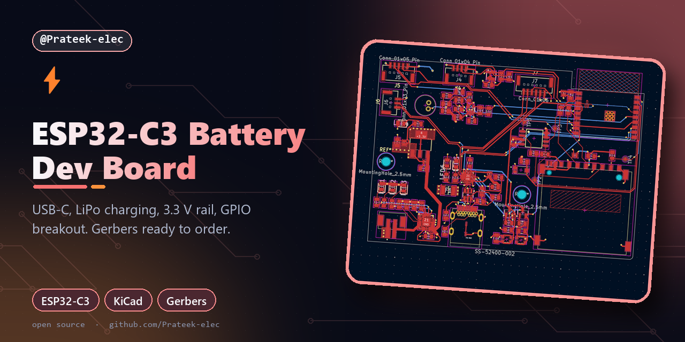

<div align="center">



**A compact ESP32-C3 development board with USB-C, single-cell LiPo charging, 3.3 V regulation and onboard sensor footprints. KiCad source and ready-to-order Gerbers included.**


</div>

---

## 🔥 Why it hits different

- 🔋 **Battery-ready:** single-cell LiPo charging built in, so your IoT node runs untethered.
- 🔌 **USB-C:** power and programming over one modern port.
- 📦 **Gerbers ready to order:** upload the zip to any fab and you're done.
- 🧪 **Sensor footprints on board:** prototype without a breadboard.

## The problem it solves

Off-the-shelf ESP32 boards usually skip the battery. This one is built for portable IoT prototypes: plug in a LiPo, charge over USB-C, and you have a Wi-Fi + BLE node that runs untethered.

## Features

- **ESP32-C3-WROOM** module (RISC-V, Wi-Fi + Bluetooth LE)
- **USB-C** power input
- **Single-cell LiPo charger** on board
- **3.3 V regulation** for the MCU and peripherals
- **BOOT / RESET** buttons for easy flashing
- **GPIO breakout headers** for expansion
- Footprints for onboard sensors (environment sensor, microphone amplifier, light sensor)
- 2.5 mm mounting holes and test points

## Files

| What | Where |
|---|---|
| Schematic (PDF) | [`docs/schematic.pdf`](docs/schematic.pdf) |
| KiCad schematic | `hardware/kicad/esp32prj.kicad_sch` |
| KiCad PCB | `hardware/kicad/esp32prj.kicad_pcb` |
| **Gerbers (ready to order)** | [`fabrication/esp32-c3-devboard-gerbers.zip`](fabrication/esp32-c3-devboard-gerbers.zip) |

## Order your own

1. Download [`fabrication/esp32-c3-devboard-gerbers.zip`](fabrication/esp32-c3-devboard-gerbers.zip).
2. Upload it as-is to any PCB fab (JLCPCB, PCBWay, etc.).
3. Use the [schematic](docs/schematic.pdf) as your parts list for assembly.

## Edit it

1. Install [KiCad](https://www.kicad.org/download/).
2. Clone the repo:
   ```bash
   git clone https://github.com/Prateek-elec/esp-devboard-prateek.git
   ```
3. Open `hardware/kicad/esp32prj.kicad_sch` and `esp32prj.kicad_pcb`.

## Roadmap

- [x] Schematic + PCB
- [x] Gerbers
- [ ] BOM / pick-and-place for assembly
- [ ] 3D renders and photos of the assembled board
- [ ] Example Arduino / ESP-IDF sketches for the onboard sensors

## License

[MIT](LICENSE) © Prateek Sarkar

---

<div align="center">

### If this made you go *"wait, that's sick"* 👀

**Drop a ⭐ so more builders find it, and share it with someone who'd build one.**

[](https://twitter.com/intent/tweet?text=An%20ESP32-C3%20dev%20board%20that%20runs%20on%20a%20LiPo%2C%20Gerbers%20included%20%E2%9A%A1&url=https%3A%2F%2Fgithub.com%2FPrateek-elec%2Fesp-devboard-prateek)
[](https://www.linkedin.com/sharing/share-offsite/?url=https%3A%2F%2Fgithub.com%2FPrateek-elec%2Fesp-devboard-prateek)
[](https://github.com/Prateek-elec)

</div>
